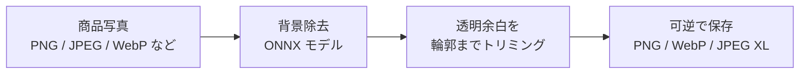

# Showcase Image Finisher

コレクションのカタログ／ショーケース用画像を作るための、Windows 向け
画像仕上げツールです。商品写真に対して **背景除去 → 透明余白の
トリミング → 可逆出力** を、複数ファイルまとめて一括で行います。

## 特徴

- **ドラッグ＆ドロップ対応** ― ドロップエリアへファイルを落とすか、
  クリックで選択。フォルダを落とすと中の画像を読み込みます
- **複数ファイルを一括処理** ― 1件ごとに進み具合と結果を表示し、
  途中で中止もできます
- **出力は可逆が既定、「容量優先」も選択可** ― PNG / WebP /
  JPEG XL から選択。容量優先をオンにすると非可逆で大幅に小さく
  なります（PNG は256色へ量子化、WebP は画質90、
  JPEG XL は distance 1.0）
- **背景除去は rembg と同一方式** ― 同じ ONNX モデルを使い、前処理
  （リサイズ → 画像の最大値で正規化 → チャンネルごとの標準化）も
  rembg の実装に合わせてあります（本体の出力と一致することを
  検証済み）。Python のインストールは不要です
- **トリミングは輪郭いっぱい** ― 背景除去で生じる微小なα値のノイズ
  （α ≤ 8）を透明として掃除してから切り取るため、被写体が小さく
  ならない、余白のない仕上がりになります
- **仕上げの選択肢** ― 輪郭のフリンジ除去、一番大きい被写体だけに
  合わせるトリミング、余白（px）の指定ができます
- **プレビューと設定の保存** ― 選択したファイルの元画像／処理後を
  その場で確認でき、設定は次回起動時に復元されます
- **テーマは3種** ― ダーク／ライト／標準（初期の既定デザイン）から
  選択できます

## 使い方

1. 画像ファイルをドロップするか、ドロップエリアをクリックして
   ファイルを追加します（複数選択可）
2. 背景除去モデル、出力形式、出力先、ファイル名の接尾辞
   （初期値 `_finished`）を設定します
3. 「実行」を押します

出力先は「入力と同じフォルダ」か「指定フォルダ」から選べます。
同名ファイルがある場合はスキップします（「同名ファイルを上書き」
をチェックすると上書きします）。

## 対応形式

| 入力 | PNG / JPEG / WebP / BMP / GIF / TIFF / ICO / AVIF / HEIC / JPEG XL など（デコードは SkiaSharp に依存します。環境によって読めない形式は、そのファイルだけエラーとして表示されます） |
|---|---|
| 出力 | PNG、WebP、JPEG XL（要 jxl.dll）。既定は可逆、「容量優先」オンで非可逆 |

## 背景除去モデル

初回実行時に、選択したモデルを
`%LOCALAPPDATA%\ShowcaseImageFinisher\models` へ自動ダウンロード
します（配布元の MD5 で検証します）。

| モデル | 特徴 |
|---|---|
| isnet-general-use | 高品質・重め（入力 1024×1024） |
| u2net | 標準（入力 320×320） |
| u2netp | 高速・軽量（入力 320×320） |

モデルは [rembg](https://github.com/danielgatis/rembg) の公式配布
（ONNX 形式）をそのまま利用しています。

## PNG の容量優先を高品質にする場合（任意）

「容量優先」オン時の PNG 量子化は、内蔵の量子化でも処理できますが、
libimagequant の DLL を置くと、より高品質な量子化になります
（パレット上限は実測に基づき192色で使います）。

- MSYS2 のパッケージ `mingw-w64-x86_64-libimagequant` などから
  x64 版 `libimagequant.dll` を取り出し、exe と同じフォルダに
  置いてください。依存は Windows 標準 DLL のみです
  入手先：[MSYS2 のパッケージページ](https://packages.msys2.org/packages/mingw-w64-x86_64-libimagequant)
- 置いてあるかどうかは、アプリ下部の注記で確認できます
- libimagequant は GPLv3（または商用ライセンス）のライブラリです。
  ソースは https://github.com/ImageOptim/libimagequant で入手できます

## JPEG XL を使う場合

libjxl 公式リリース（0.11 以降）の **x64 版**パッケージ
`jxl-x64-windows.zip` から、次の DLL をすべて取り出し、この
アプリの exe と同じフォルダに置いてください。

- `jxl.dll`、`jxl_threads.dll`、`jxl_cms.dll`
- `brotlicommon.dll`、`brotlidec.dll`、`brotlienc.dll`

32bit（x86）版や ARM64 版など、ビット数の違う DLL は読み込め
ません。アプリ下部の注記に、置いた DLL のビット数や不足して
いる依存 DLL が表示されます。依存 DLL をすべて置いても
読み込めない場合は、Microsoft Visual C++ 再頒布可能
ランタイム（x64）のインストールが必要です
（https://aka.ms/vs/17/release/vc_redist.x64.exe ）。
DLL が無い場合は JPEG XL だけがエラーになり、PNG / WebP は
そのまま使えます。

- libjxl: https://github.com/libjxl/libjxl/releases

## ビルドと実行

- Visual Studio 2022 と .NET 8 SDK で `ShowcaseImageFinisher.sln`
  を開いてビルドします
- 実行には .NET 8 Desktop Runtime が必要です
  （フレームワーク依存の構成です）

## 使用ライブラリ

- [ONNX Runtime](https://onnxruntime.ai/) ― 背景除去モデルの実行
- [SkiaSharp](https://github.com/mono/SkiaSharp) ― 画像の入出力と加工
- [libjxl](https://github.com/libjxl/libjxl) ― JPEG XL 出力（任意、DLL を別途配置）
- [libimagequant](https://github.com/ImageOptim/libimagequant) ― PNG の量子化（任意、DLL を別途配置）

---

## Summary (English)

A Windows (WPF) batch tool that finishes product photos for collection
catalogs and showcases: background removal with the same ONNX models
and preprocessing as rembg (verified to match rembg's output), tight
trimming of transparent margins (cleaning near-zero alpha noise first),
and lossless export to PNG, WebP, or JPEG XL (via libjxl, DLL not
bundled). Drag & drop or click to add files, process many at once.
